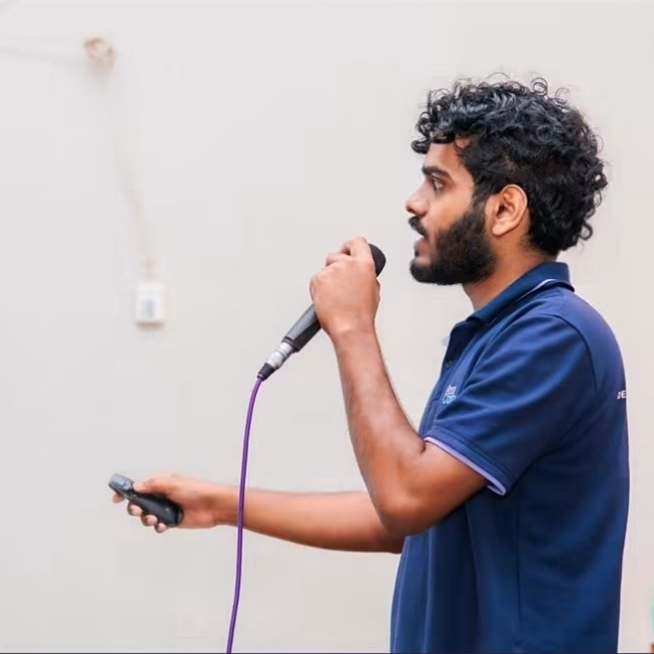
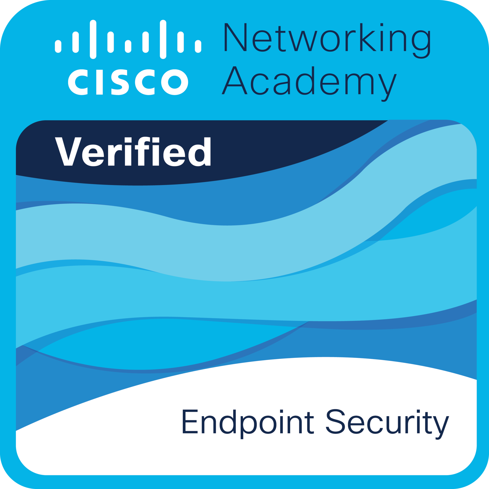
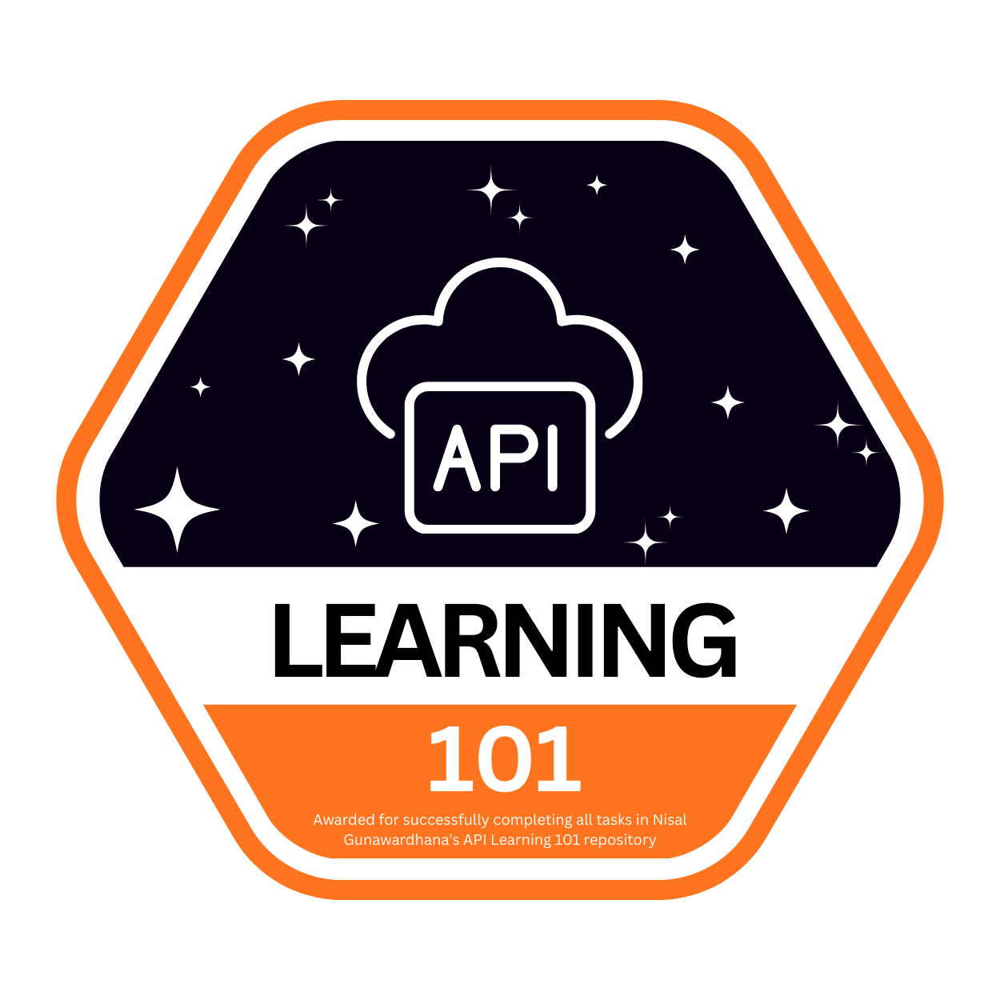
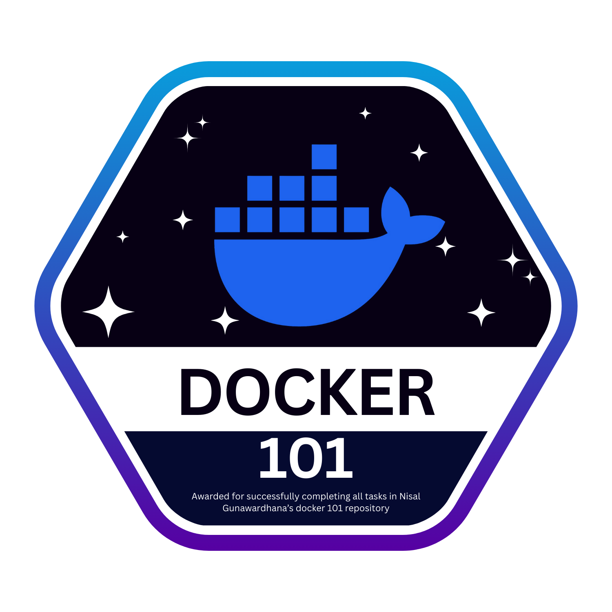

<!-- ═══════════════════════════════════════════════════════════════════════ -->
<!-- 🌊  HEADER BANNER                                                      -->
<!-- ═══════════════════════════════════════════════════════════════════════ -->

  

<!-- ═══════════════════════════════════════════════════════════════════════ -->
<!-- ⌨️  TYPING ANIMATION & PHILOSOPHY                                       -->
<!-- ═══════════════════════════════════════════════════════════════════════ -->

  

  <em>"All models are wrong, but some are useful!"</em> &nbsp;•&nbsp; <em>"Sometimes it takes a mistake to learn from it."</em>

  📍 <strong>07.2537° N, 80.5922° E · Peradeniya / Mirigama, Sri Lanka</strong> &nbsp;|&nbsp; 🟢 <strong>BUILDING · Computer Engineering, UoP</strong>

<!-- ═══════════════════════════════════════════════════════════════════════ -->
<!-- 🔗  QUICK NAVIGATION & CONNECT BADGES                                   -->
<!-- ═══════════════════════════════════════════════════════════════════════ -->

  
  &nbsp;
  
  &nbsp;
  
  &nbsp;
  
  &nbsp;
  
  &nbsp;
  

  
  &nbsp;
  
  &nbsp;
  

---

<!-- ═══════════════════════════════════════════════════════════════════════ -->
<!-- 🚀  ABOUT ME & ACTIVE RADAR                                            -->
<!-- ═══════════════════════════════════════════════════════════════════════ -->
## 👨‍💻 About Me

<table>
  <tr>
    <td width="65%" valign="top">
      

        I am a <strong>Computer Engineering undergraduate</strong> at the <a href="https://www.pdn.ac.lk/" target="_blank"><strong>University of Peradeniya</strong></a>, Sri Lanka, and the elected <strong>Secretary of <a href="https://aces.ce.pdn.ac.lk/" target="_blank">ACES</a></strong> (Association of Computer Engineering Students).
      

      

        My technical passion sits at the convergence of <strong>Artificial Intelligence, On-Device Multi-Agent Systems, Audio ML & Signal Processing, Computer Architecture, and Cybersecurity</strong>. I take pride in building robust, high-performance systems from first principles — whether crafting software 3D renderers in pure C, restoring severely degraded optical signals, or deploying edge AI defense mechanisms.
      

      

        <strong>📡 Current Radar & Active Work:</strong>
        <ul>
          <li>🌿 <strong><a href="https://github.com/cepdnaclk/e22-3yp-NETH" target="_blank">NETH (3YP)</a>:</strong> Low-power cyber-physical system for intelligent wildlife monitoring using Edge AI, camera traps, environmental sensing, and LoRa telemetry.</li>
          <li>🏎️ <strong><a href="https://github.com/zerokali20/AI-Hardware-Roadmap" target="_blank">AI-Hardware-Roadmap</a>:</strong> Open-source curriculum covering RTL verification, FPGA AI accelerators, RISC-V, and neuromorphic computing.</li>
          <li>🛡️ <strong><a href="https://github.com/zerokali20/panopticon-tiramisu" target="_blank">panopticon-tiramisu</a>:</strong> Real-time on-device multi-agent defense countering voice phishing (vishing) and deepfakes.</li>
        </ul>
      

    </td>
    <td width="35%" align="center" valign="middle">
      
        
      
    </td>
  </tr>
</table>

---

<!-- ═══════════════════════════════════════════════════════════════════════ -->
<!-- 🗺️  TRAJECTORY & EXPERIENCE                                            -->
<!-- ═══════════════════════════════════════════════════════════════════════ -->
## 🧭 Trajectory & Leadership

| Period | Role | Organization / Initiative | Key Highlights & Scope |
| :--- | :--- | :--- | :--- |
| **2026 — Present** | **Secretary** | **ACES** · University of Peradeniya | Leading student governance, technical events, community hackathons, and corporate/industry networking for computer engineering students. |
| **2026 — Present** | **AI & Security Developer** | **Panopticon Project** | Engineered an on-device multi-agent AI system defending against deepfake voice phishing. Won **1st Place (Champions)** at the Aurora AI Ideathon 2026. |
| **2025 — 2026** | **Lead ML Developer** | **Team Invictus** · CO2060 2YP | Architected **PERA-SAM**, an ML acoustic signal classification & societal impact software suite; built feature extraction pipelines, data modeling, and web services. |
| **2024 — Present** | **Computer Engineering Undergraduate** | **University of Peradeniya** | Pursuing BSc (Hons) in Computer Engineering. Active member of <a href="https://www.ce.pdn.ac.lk/" target="_blank">@cepdnaclk</a> covering AI/ML, OS, Computer Networks, and Architecture. |

---

<!-- ═══════════════════════════════════════════════════════════════════════ -->
<!-- 💻  FEATURED PROJECTS (CATEGORIZED)                                    -->
<!-- ═══════════════════════════════════════════════════════════════════════ -->
## 🚀 Featured Projects

### 🧠 1. Artificial Intelligence & Machine Learning

<table>
  <thead>
    <tr>
      <th width="45%">Project</th>
      <th width="35%">Key Technologies</th>
      <th width="20%">Links</th>
    </tr>
  </thead>
  <tbody>
    <tr>
      <td>
        <strong>panopticon-tiramisu</strong> 🏆 
        <em>On-Device Multi-Agent Voice Phishing & Deepfake Defense</em> 
        Real-time audio perception, autonomous reasoning, and proactive user intervention countering vishing threats with privacy-preserving edge models.
      </td>
      <td>
        <code>Multi-Agent AI</code> <code>Audio Processing</code> <code>On-Device ML</code> <code>Python</code>
      </td>
      <td>
        <a href="https://github.com/zerokali20/panopticon-tiramisu"><strong>Repository ↗</strong></a> 
        <em>Aurora 2026 Winner</em>
      </td>
    </tr>
    <tr>
      <td>
        <strong>PERA-SAM</strong> 🎧 
        <em>Acoustic Signal Classification & Societal Diagnostic Suite</em> 
        End-to-end sound analysis system solving real-world challenges using acoustic machine learning algorithms, trained models, and cloud web services.
      </td>
      <td>
        <code>Audio ML</code> <code>TypeScript</code> <code>Python</code> <code>Azure</code> <code>scikit-learn</code>
      </td>
      <td>
        <a href="https://github.com/zerokali20/e22-co2060-PERA-SAM"><strong>Repository ↗</strong></a> 
        <a href="https://proud-glacier-05c9fb600.7.azurestaticapps.net/"><strong>Live Demo ↗</strong></a>
      </td>
    </tr>
  </tbody>
</table>

### ⚡ 2. Cyber-Physical Systems, Hardware & Edge Computing

<table>
  <thead>
    <tr>
      <th width="45%">Project</th>
      <th width="35%">Key Technologies</th>
      <th width="20%">Links</th>
    </tr>
  </thead>
  <tbody>
    <tr>
      <td>
        <strong>NETH (3YP)</strong> 🌿 
        <em>Cyber-Physical Edge AI Wildlife Monitoring System</em> 
        Low-power intelligent wildlife monitoring infrastructure combining edge camera traps, environmental multi-sensor arrays, edge inference, and long-range LoRa wireless communication.
      </td>
      <td>
        <code>Edge AI</code> <code>LoRa</code> <code>C++</code> <code>Embedded Systems</code> <code>IoT</code>
      </td>
      <td>
        <a href="https://github.com/cepdnaclk/e22-3yp-NETH"><strong>Repository ↗</strong></a> 
        <em>Active 3YP Project</em>
      </td>
    </tr>
    <tr>
      <td>
        <strong>AI-Hardware-Roadmap</strong> 🏎️ 
        <em>RTL to FPGA AI Accelerators & Neuromorphic Computing</em> 
        Comprehensive, open-source curriculum and reference repository taking engineers from Verilog/RTL design and verification to FPGA neural accelerators and RISC-V compute.
      </td>
      <td>
        <code>Verilog / RTL</code> <code>FPGA</code> <code>RISC-V</code> <code>Hardware AI</code>
      </td>
      <td>
        <a href="https://github.com/zerokali20/AI-Hardware-Roadmap"><strong>Repository ↗</strong></a> 
        <em>Open Source</em>
      </td>
    </tr>
  </tbody>
</table>

### ⚙️ 3. Systems Programming, Simulation & Graphics

<table>
  <thead>
    <tr>
      <th width="45%">Project</th>
      <th width="35%">Key Technologies</th>
      <th width="20%">Links</th>
    </tr>
  </thead>
  <tbody>
    <tr>
      <td>
        <strong>4lG0ciTy</strong> 🏙️ 
        <em>High-Performance Municipal Infrastructure & Grid Simulator</em> 
        City-scale infrastructure simulator written in modern C++ utilizing custom Graph networks, Tree hierarchies, and Hash Table indexing for simulated municipal records and instant routing.
      </td>
      <td>
        <code>C++</code> <code>Graph Algorithms</code> <code>Data Structures</code> <code>Simulation</code>
      </td>
      <td>
        <a href="https://github.com/zerokali20/4lG0ciTy"><strong>Repository ↗</strong></a>
      </td>
    </tr>
    <tr>
      <td>
        <strong>libtiny3d</strong> 🎮 
        <em>Pure C Software 3D Graphics Renderer</em> 
        Lightweight 3D software rendering engine built in pure C from first principles without GPU dependencies. Contributed to mathematical projection pipelines and rasterization efficiency.
      </td>
      <td>
        <code>C</code> <code>3D Mathematics</code> <code>Rasterization</code> <code>Software Rendering</code>
      </td>
      <td>
        <a href="https://github.com/GayashaSandeepa/libtiny3d"><strong>Repository ↗</strong></a> 
        <em>Contributor</em>
      </td>
    </tr>
  </tbody>
</table>

### 🌐 4. Full-Stack Engineering, Databases & Resilient Web Apps

<table>
  <thead>
    <tr>
      <th width="45%">Project</th>
      <th width="35%">Key Technologies</th>
      <th width="20%">Links</th>
    </tr>
  </thead>
  <tbody>
    <tr>
      <td>
        <strong>ArbiterPay</strong> 💳 🤖 
        <em>AI-Powered Milestone Payments & Code Verification Platform</em> 
        Built for the <strong>Build What's Next with PayPal and AI</strong> challenge. Combines PayPal milestone payments and automated payouts with AI-powered code verification against agreed acceptance criteria. Governed by a strict rule-based policy: <em>AI never moves money. Code decides.</em>
      </td>
      <td>
        <code>Next.js</code> <code>TypeScript</code> <code>PostgreSQL</code> <code>Claude AI</code> <code>PayPal APIs</code> <code>AG Grid</code>
      </td>
      <td>
        <a href="https://lnkd.in/gFt_ueYc"><strong>Repository ↗</strong></a> 
        <a href="https://lnkd.in/g8hbVu-d"><strong>Live Demo ↗</strong></a> 
        <a href="https://lnkd.in/p/gpwwv5nw"><strong>Post ↗</strong></a>
      </td>
    </tr>
    <tr>
      <td>
        <strong>Forensic-Medicine-Database</strong> 🏥 
        <em>Medical Records & Forensic Case Management Integration</em> 
        Production-ready relational database management system for the Faculty of Medicine, University of Peradeniya, enforcing ACID transactional integrity and strict role-based access.
      </td>
      <td>
        <code>MySQL</code> <code>Relational DB</code> <code>Database Design</code> <code>SQL</code>
      </td>
      <td>
        <a href="https://github.com/zerokali20/Forensic-Medicine-Database"><strong>Repository ↗</strong></a>
      </td>
    </tr>
    <tr>
      <td>
        <strong>Travel Bokka</strong> 🗺️ 
        <em>Resilient Offline-First Cultural & Transit Companion</em> 
        PWA designed for independent travelers navigating Sri Lanka's local transit nuances and cultural landscapes with robust offline capability and transit routing.
      </td>
      <td>
        <code>PWA</code> <code>Offline-First</code> <code>JavaScript</code> <code>Transit API</code>
      </td>
      <td>
        <a href="https://github.com/Agentrix-ComES/AGENTRIX26-TEAM06-Tiramissu"><strong>Repository ↗</strong></a> 
        <em>Agentrix 2026 Hackathon</em>
      </td>
    </tr>
  </tbody>
</table>

---

<!-- ═══════════════════════════════════════════════════════════════════════ -->
<!-- 🏆  HONORS & AWARDS                                                    -->
<!-- ═══════════════════════════════════════════════════════════════════════ -->
## 🏆 Honors & Achievements

<table>
  <tr>
    <td width="50%" valign="top">
      <h3>🥇 Aurora 2026 AI Ideathon — Champions</h3>
      

        <strong>1st Place (Winners)</strong> out of <strong>60+ competitive university teams</strong> across Sri Lanka.
      

      <ul>
        <li>Pitched and developed <strong>panopticon-tiramisu</strong>: an on-device multi-agent AI system mitigating deepfake voice phishing and synthetic audio scams.</li>
        <li>Awarded Champions for practical architecture, user privacy design, and real-time defense.</li>
      </ul>
      

        🔗 <a href="https://www.linkedin.com/posts/bhagya-karunanayake-b52085270_auroraai2026-ideathon-agenticai-ugcPost-7484819669502164992-JC8o/" target="_blank"><strong>View LinkedIn Announcement ↗</strong></a>
      

    </td>
    <td width="50%" valign="top">
      <h3>🎯 Mora SP Cup 2026 — Grand Finale (Top 8)</h3>
      

        <strong>Grand Finalist (Top 8 Teams)</strong> · Organized by Dept. of Electronic & Telecommunication Engineering, University of Moratuwa.
      

      <ul>
        <li>Competed with <strong>Team SENTINELS</strong> in the <strong>Low-Light Image Denoising Challenge</strong>.</li>
        <li>Engineered advanced image restoration pipelines restoring severely degraded visual signals under extreme low-light conditions.</li>
      </ul>
      

        🔗 <a href="https://lnkd.in/grAyjfJv" target="_blank"><strong>Technical Work ↗</strong></a> &nbsp;|&nbsp; <a href="https://lnkd.in/p/gVcZRBi4" target="_blank"><strong>LinkedIn Post ↗</strong></a>
      

    </td>
  </tr>
  <tr>
    <td width="50%" valign="top">
      <h3>⚡ Agentrix 2026 — 12-Hour National Hackathon</h3>
      

        <strong>Placed 12th</strong> out of 40 university teams · Faculty of Engineering, University of Ruhuna.
      

      <ul>
        <li>Designed, built, and shipped <strong>Travel Bokka</strong> within a rigorous 12-hour sprint with Team Tiramissu.</li>
        <li>Delivered an offline-first resilient transit and travel assistant application for local commuters and tourists.</li>
      </ul>
    </td>
    <td width="50%" valign="top">
      <h3>🛡️ TryHackMe Cybersecurity & CTF Competitions</h3>
      

        <strong>Active Security Researcher & CTF Solver</strong> across defensive cybersecurity and security engineering.
      

      <ul>
        <li>Completed hands-on labs in Network Concepts, Security Engineering, Linux Fundamentals, and Endpoint Forensics.</li>
        <li>Holder of Pre Security Path Certification and Advent of Cyber honors.</li>
      </ul>
    </td>
  </tr>
</table>

---

<!-- ═══════════════════════════════════════════════════════════════════════ -->
<!-- 📜  CERTIFICATIONS & CREDENTIALS                                       -->
<!-- ═══════════════════════════════════════════════════════════════════════ -->
## 📜 Certifications & Verified Credentials

  
  &nbsp;
  
  &nbsp;
  
  &nbsp;
  

  
  &nbsp;&nbsp;&nbsp;
  
  &nbsp;&nbsp;&nbsp;
  
  &nbsp;&nbsp;&nbsp;
  
  &nbsp;&nbsp;&nbsp;
  
  &nbsp;&nbsp;&nbsp;
  
  &nbsp;&nbsp;&nbsp;
  
  &nbsp;&nbsp;&nbsp;
  
  &nbsp;&nbsp;&nbsp;
  
  &nbsp;&nbsp;&nbsp;
  
  &nbsp;&nbsp;&nbsp;
  

---

<!-- ═══════════════════════════════════════════════════════════════════════ -->
<!-- 🧰  TECHNICAL TOOLKIT & SKILLS                                         -->
<!-- ═══════════════════════════════════════════════════════════════════════ -->
## 🛠️ Technical Toolkit

  <strong>Programming Languages</strong> 
  
  
  
  
  
  

  <strong>AI, Machine Learning & Signal Processing</strong> 
  
  
  
  
  

  <strong>Web & Full-Stack Development</strong> 
  
  
  
  
  
  

  <strong>Databases & Cloud Infrastructure</strong> 
  
  
  
  
  
  
  
  

  <strong>Hardware, Robotics & Cybersecurity</strong> 
  
  
  
  
  
  

---

<!-- ═══════════════════════════════════════════════════════════════════════ -->
<!-- 📊  GITHUB ANALYTICS & ACTIVITY                                        -->
<!-- ═══════════════════════════════════════════════════════════════════════ -->
## 📊 GitHub Analytics

  
  &nbsp;
  

  

<!-- Snake Contribution Graph -->

  

---

<!-- ═══════════════════════════════════════════════════════════════════════ -->
<!-- 📬  CONNECT & CONTACT                                                  -->
<!-- ═══════════════════════════════════════════════════════════════════════ -->
## 📬 Let's Connect

Whether you want to discuss AI research, systems programming, open-source initiatives, or potential collaborations — my inbox is always open!

<table align="center">
  <tr>
    <td align="center">
      
    </td>
    <td align="center">
      
    </td>
    <td align="center">
      
    </td>
  </tr>
  <tr>
    <td align="center">
      
    </td>
    <td align="center">
      
    </td>
    <td align="center">
      
    </td>
  </tr>
  <tr>
    <td align="center">
      
    </td>
    <td align="center">
      
    </td>
    <td align="center">
      
    </td>
  </tr>
</table>

   
  <h3>💫 <em>"The best way to predict the future is to create it."</em> 💫</h3>
  
Crafted with precision by <strong>Bhagya Karunanayake</strong> (zerokali20) · Computer Engineering, University of Peradeniya

   
  

